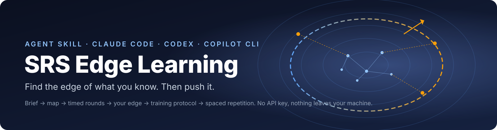
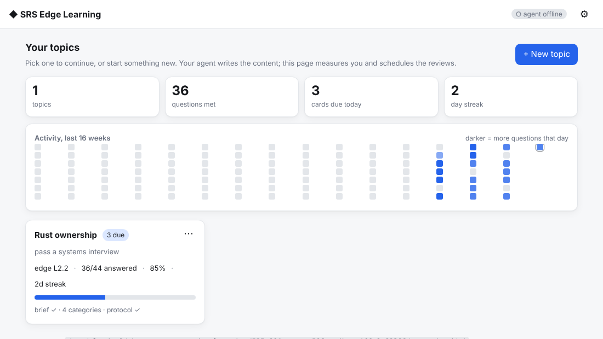
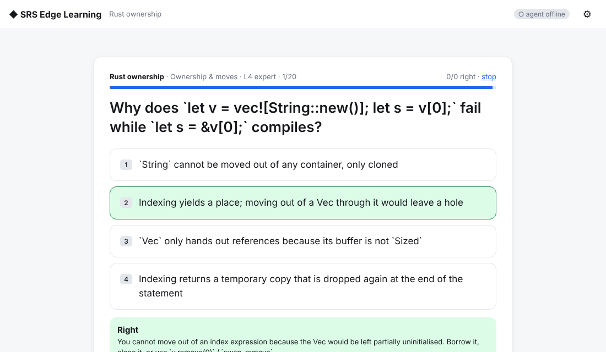
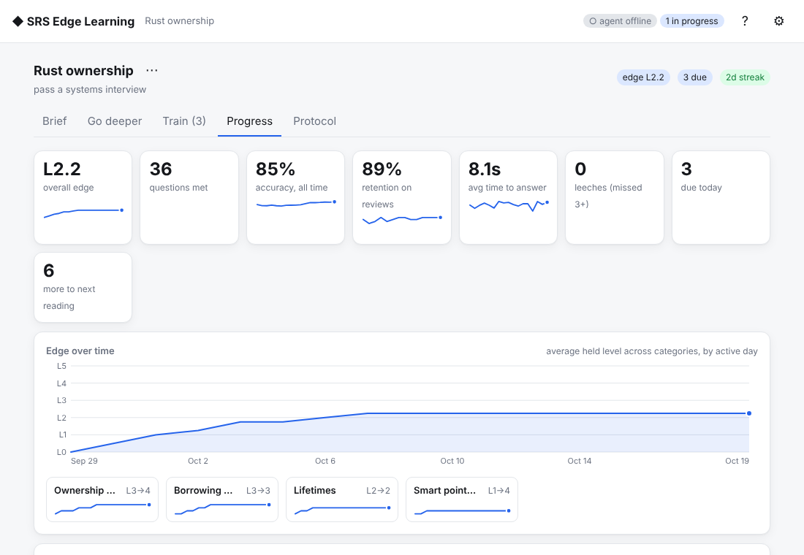
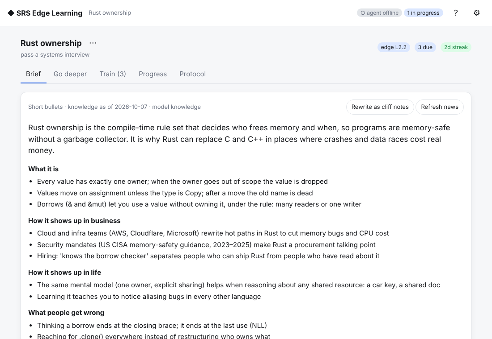
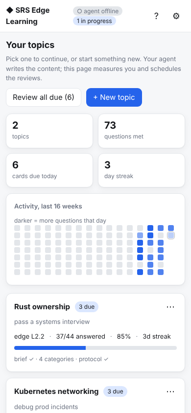
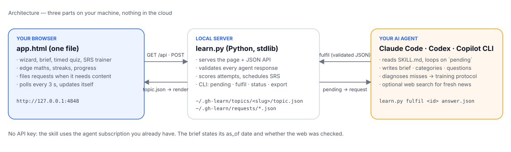
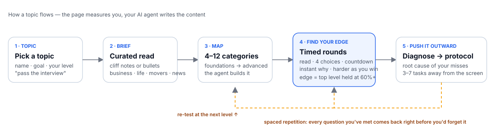

# SRS Edge Learning

    

**Get smart at any topic by finding the edge of what you know, then pushing it outward.**

A skill for AI coding agents (Claude Code, Codex CLI, GitHub Copilot CLI) plus a small local web page. You name a topic. Your agent writes a brief, maps the topic into categories, and drills you with timed multiple-choice questions that get harder until they find your edge. It diagnoses your misses into a training protocol and schedules spaced-repetition reviews so what you learn stays learned. No API key: it runs on the agent you already have. Nothing leaves your machine.

## Install in one line

**macOS / Linux**
```bash
curl -fsSL https://raw.githubusercontent.com/GGCryptoh/srs-edge-learning/main/install.sh | bash
```

**Windows (PowerShell)**
```powershell
irm https://raw.githubusercontent.com/GGCryptoh/srs-edge-learning/main/install.ps1 | iex
```

Then open your agent in a new session and type `/srs-edge-learning <topic>`.

Prefer a zip? [Download srs-edge-learning.zip](https://github.com/GGCryptoh/srs-edge-learning/releases/latest/download/srs-edge-learning.zip) and unzip it into `~/.claude/skills/` (or `~/.codex/skills/`, `~/.copilot/skills/`). [Manual steps](#manual-install) are below.

## What it looks like

| Home: every topic, activity, what's due | A timed question with instant feedback |
|---|---|
|  |  |

| Progress: your edge over time, per category | The brief, written for your goal |
|---|---|
|  |  |



## Why

Most of us "learn" by consuming: read the article, watch the video, ask the chatbot to explain it, nod, move on. A week later it is gone. Memory research has known for a century why: knowledge sticks when you **produce** it under a little pressure (answer, get corrected, try again), and it sticks best when the questions land just past the edge of what you already know. AI makes the consuming side effortless, which is exactly the trap. This flips it: the agent becomes the examiner, roadmap builder, explainer and flashcard clerk, and you do the producing.

I built it because it already worked on me: spaced repetition and timed recall compressed almost two years of Mandarin levelling into eleven months. The pattern is simple. Test before you study, keep every question just past your edge, and let scheduling decide what comes back.

## How it works

1. **Brief.** Cliff notes or short bullets, written for *your* goal ("pass an interview", "explain it to a client"): what it is, where it shows up in business and life, who the movers are, what happened recently, the words to know. It says what date its knowledge is from and whether the web was checked.
2. **Map.** The agent splits the topic into 4 to 12 categories, foundations first.
3. **Find your edge.** Timed rounds: a few seconds to read, then four choices and a countdown. Right or wrong shows instantly with a one-line explanation. Per category the page works out your edge, the hardest level you still hold at 60% or better, and pitches the next questions one level above it.
4. **Push it outward.** *Diagnose my misses* has the agent name the one misunderstanding behind most of them and write a 3 to 7 step training protocol to do away from the screen. Every question you have met becomes a review card that comes back right before you would forget it.

Come back next week and the same page has every topic, your edge per category, your streak, and what is due.

## Features

| | |
|---|---|
| **Adaptive, timed rounds** | Read phase, four choices, countdown, keyboard 1 to 4. Questions climb a five-level ladder from definitions to the open questions of the field. |
| **Edge per category** | Held at 60%+ over three questions; 80%+ moves you up a level, 40% or less moves you down. |
| **Hammer my weakest** | One click drills your weakest category, re-asking what you got wrong before anything new. Does not move your edge. |
| **Spaced repetition** | SM-2 style scheduling per card. Review per topic, or *Review all due* across every topic from the home page. |
| **Diagnosis and protocol** | Root causes behind your misses, a checklist of production tasks, and a re-test date. |
| **Progress you can see** | Edge over time (overall and per category), 7-day rolling accuracy, review retention, seconds to answer, a 16-week activity heatmap, your streak. |
| **Per-question stats** | Times seen, times wrong, average time, last seen. Leeches (missed three or more times) and "wrong last time" are flagged, and the diagnosis sees them. |
| **Flag a bad question** | The agent can write a wrong answer key. Flag it with a reason: it leaves the bank, the edge maths and the deck, the agent is told why and writes a replacement. Restorable. |
| **Honest questions** | Four distinct choices, one answer, no all-of-the-above, shuffled slots. The validator rejects batches where the longest or shortest option gives the answer away. |
| **Manage topics** | Rename, change goal and level, archive, export as JSON, delete with undo (to a trash folder). |
| **Backup and move machines** | One zip with every topic and your settings. Restore it anywhere, or import a single exported topic. |
| **Local and private** | One folder on your machine, atomic writes, nothing uploaded. The brief carries its knowledge date. |
| **Plays well with others** | If port 4848 is busy the hub takes the next free one. Two agents can serve one hub: each request is claimed once and every write is locked. |
| **Portable** | Standard-library Python and one HTML file. macOS, Windows, Linux. Claude Code, Codex, Copilot CLI. Light and dark, desktop and phone. |

## Five-minute walkthrough

1. Install (above). In your agent, type `/srs-edge-learning Kubernetes networking` or whatever you want to get smart at.
2. The hub opens in your browser. Pick **Cliff notes**. Within a minute the brief appears.
3. **Go deeper → Build the map**, then **Start a round**. Answer with the number keys. Stop when you like.
4. Open **Progress** for your edge per category. Press **Diagnose my misses**.
5. Tomorrow, open **Train** (or **Review all due** on the home page) and clear what is due. Repeat.

The **?** button on the page has the same guide, the keyboard shortcuts, and the prompt that summons your agent.

## What you need

- A Mac, Windows or Linux machine with Python 3.9 or newer. Macs have it.
- An AI coding agent that reads skills: Claude Code, Codex CLI, or GitHub Copilot CLI. No API key is needed by the skill itself.
- Five minutes to install.

## Command line

The page covers daily use. Everything is also a command, which is how the agent drives it:

| Command | Does |
|---|---|
| `learn.py open [slug]` | Start the hub if needed (detached) and open the browser. Prints the URL. |
| `learn.py add "<topic>" [--goal …] [--level 1-5]` | Create a topic. |
| `learn.py topics [--all]` · `status [slug]` · `stats <slug>` | Overview, edge per category, per-question stats and leeches. |
| `learn.py pending [--wait S] [--peek]` · `fulfil <id> <file>` · `validate <file> --type T` | The agent's loop: read requests with context, answer them with validated JSON. |
| `learn.py misses <slug>` · `due <slug>` · `export <slug>` | Recent wrong answers, cards due, a progress markdown file. |
| `learn.py rename` · `archive` · `unarchive` · `remove` · `undelete` | Topic management. |
| `learn.py questions <slug> [--retired]` · `retire <slug> <qid> --reason …` | List question ids; retire or restore one. |
| `learn.py backup [--out f.zip]` · `restore <zip or topic.json> [--overwrite]` | Backup everything; import on another machine. |

Data lives in `~/.gh-learn/` (set `LEARN_HOME` to move it, for example into a project folder).

## Honest limits

- Multiple choice only. That keeps the timer fair and the edge maths honest, but it will not grade an essay. The training protocol is where the free-form work lives.
- The agent writes questions in batches of 10 to 12. When the bank runs low mid-round the page asks for more and you wait a minute.
- The agent can write a wrong answer key. The validator catches structure and length tells, not facts; that is what the flag button is for.
- News and movers are only as fresh as your agent's web access. The brief says.

## Manual install

Copy `skill/srs-edge-learning/` into your agent's skills folder: `~/.claude/skills/` for Claude Code, `~/.codex/skills/` for Codex, `~/.copilot/skills/` for Copilot CLI. Then `python3 ~/.claude/skills/srs-edge-learning/scripts/learn.py setup`.

## Repository

```
skill/srs-edge-learning/   the skill: SKILL.md, scripts/learn.py, assets/app.html, references/, examples/, evals/, tests/
install.sh · install.ps1   one-line installers (download the release zip into the skills folder)
docs/                      header, diagrams, screenshots
.github/workflows/         ci.yml (tests on Linux, macOS, Windows) · release.yml (builds the zip on a v* tag)
```

Run the tests with `python3 -m unittest discover -s skill/srs-edge-learning/tests`. To see every screen with data, `learn.py restore skill/srs-edge-learning/examples/sample-topic.json` then `learn.py open rust-ownership`.

Built by Geoff Hopkins. MIT licensed.




